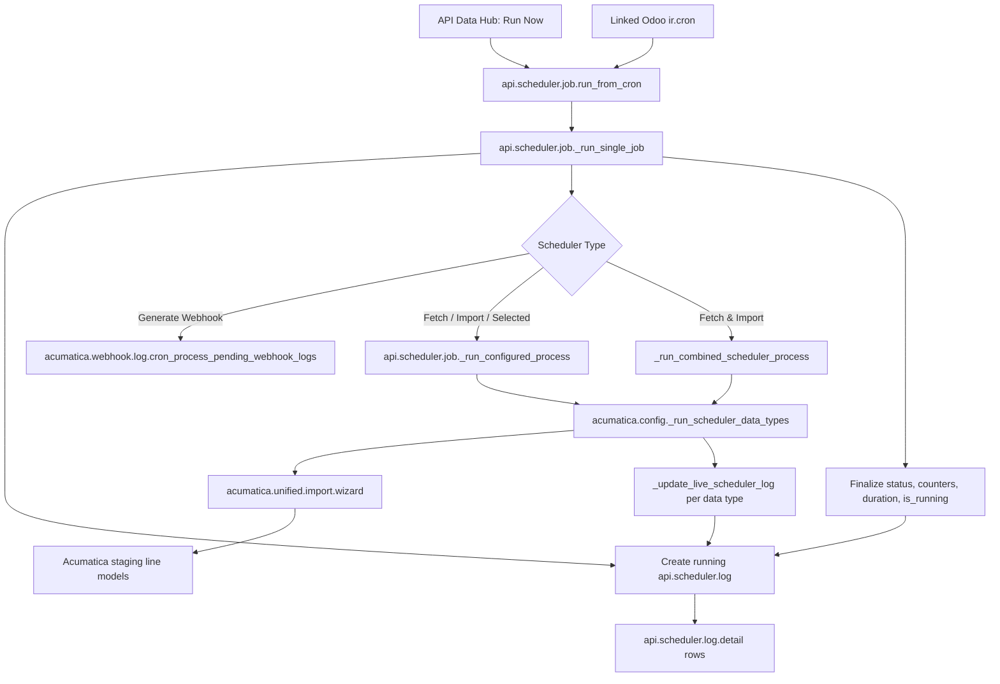

# API Data Hub Scheduler: Architecture and Usage Map

This document maps the scheduler implementation currently present in `acumatica_all_import`. “In use” below means referenced by the current Python/XML/view source. It does not confirm custom `ir.cron` records that may exist only in a live database.

## Scope

The scheduler is the remote control surface for Odoo `ir.cron`: users configure the linked cron from API Data Hub without needing to work from the Odoo Scheduled Actions menu. `api.scheduler.job` stores the business selection and links to an `ir.cron`; the cron calls back into the job model, which dispatches the configured operation.

Included scheduler types:

| Scheduler Type | Behavior |
| --- | --- |
| Fetch All Master | Fetch every key in `MASTER_DATA_TYPES` into staging. |
| Import All Master | Import eligible staged master rows, gated by the latest successful fetch log. |
| Fetch & Import All Master | Fetch each master type, then import types fetched successfully with data. |
| Fetch All Transaction | Fetch every key in `TRANSACTION_TYPES` into staging. |
| Import All Transaction | Import eligible staged transaction rows, gated by the latest successful fetch log. |
| Fetch & Import All Transaction | Fetch each transaction type, then import types fetched successfully with data. |
| Single Fetch | Fetch the selected Import Data type(s) for the selected category. |
| Single Import | Import the selected staged Import Data type(s) for the selected category. |
| Generate Webhook | Process pending Acumatica webhook logs. |

The user-facing labels say “Single”, while the `selected_data_type_ids` field is Many2many; selecting multiple types runs the corresponding per-type loop for each selection.

## Runtime Architecture

### Entry points and dispatch

- `models/api_scheduler.py::action_run_now` is the UI button entry point; it delegates to `run_from_cron`.
- `models/api_scheduler.py::run_from_cron` is the `ir.cron` code entry point too. The seeded cron records call `model.browse(...).run_from_cron()`.
- `models/api_scheduler.py::_run_single_job` handles availability, overlap check, running state, log lifecycle, exception capture, duration, and final counters.
- `_SCHEDULER_JOB_TYPES` maps the master/transaction and selected fetch/import types to category and phase. `generate_webhook` is dispatched explicitly to `acumatica.webhook.log.cron_process_pending_webhook_logs`.
- `_run_configured_process` resolves either all category keys from `acumatica.unified.import.wizard` or selected keys from `api.scheduler.data.type`, then delegates to `acumatica.config._run_scheduler_data_types`.
- `_run_combined_scheduler_process` performs fetch first and only sends types with a successful fetch and `data_retrieved > 0` to import.
- `models/acumatica_cronjob.py::_run_scheduler_data_types` is the active per-type execution engine. It checks import eligibility where applicable, creates a unified import wizard for each type, fetches or imports inside a database savepoint, and updates scheduler log details.

### Log lifecycle

1. `_run_single_job` snapshots staging counters and creates a `running` log.
2. It commits the running marker/log before invoking the configured process so progress is visible while work continues.
3. `_run_scheduler_data_types` writes one detail row per data type through `_update_live_scheduler_log`; totals are recalculated on the parent log.
4. `_run_single_job` takes a second snapshot, builds/finalizes detail values, duration, message, and `success`/`failed` status, and clears `is_running`.
5. If the job is skipped because `do_not_overlap` sees `is_running`, it creates a failed log with a skip explanation.

Webhook processing is routed to its own webhook-log processor. The generic scheduler log lifecycle wraps that call, but webhook-specific per-message log repair/visibility is outside this scheduler split and remains follow-up scope.

## Core Models, Fields, and Methods

### `api.scheduler.data.type`

| Field / method | Role | Current use |
| --- | --- | --- |
| `name` | Display label for a supported Import Data type. | Selection labels in scheduler forms/log details. |
| `code` | Stable technical key. | Lookup into `ImportWizard.IMPORT_MAP`; unique SQL constraint. |
| `data_category` | Master vs transaction classification. | Filters selected records and validates category consistency. |
| `sequence` | Ordering in scheduler selection. | Model ordering. |
| `get_selection()` | Returns `(code, name)` choices. | Dynamic `acumatica_data` selection in log details. |

### `api.scheduler.job`

| Field | Core? | Role / consumers |
| --- | --- | --- |
| `name` | Yes | Job label shown in scheduler views. |
| `code` | Yes | Technical identifier; unique and displayed in list. It is not the dispatch key; `job_type` controls execution. |
| `description` | Supporting | Human-readable description only. |
| `active` | Yes | “Scheduler Available”; `_run_single_job` returns without executing when false. This is separate from `ir.cron.active`. |
| `job_type` | Yes | Operation selector used by dispatch, category selection, combined-run behavior, and log data mapping. |
| `selected_data_category` | Yes for selected modes | Selects master or transaction for Single Fetch/Import. |
| `selected_data_type_ids` | Yes for selected modes | Many2many of supported data types. Category onchange clears incompatible selections; constraint rejects mixed categories. |
| `do_not_overlap` | Yes | Enables the `is_running` check in `_run_single_job`. See concurrency limitation below. |
| `is_running` | Yes | Read-only runtime flag set/reset by `_run_single_job`; used by overlap guard and shown in views. |
| `ir_cron_id` | Yes | Link to the Odoo cron record; target for schedule settings and “Open Odoo Cron”. |
| `cron_active` | Yes | Writable related field to `ir.cron.active`; enables/disables scheduled execution. |
| `cron_interval_number`, `cron_interval_type` | Yes | Writable related fields to the cron recurrence. |
| `cron_nextcall` | Yes | Writable related field to the next execution timestamp. |
| `cron_user_id` | Yes | Writable related field to the execution user. |
| `log_ids` | Yes | One2many used by the scheduler Log Activity tab. |

### Core scheduler methods

| Method | Why it is core |
| --- | --- |
| `_onchange_selected_data_category` | Clears selected types that no longer match the selected category. |
| `_check_selected_data_category` | Server-side validation of selected type/category consistency. |
| `action_run_now` | UI manual-run action. |
| `action_open_ir_cron` | Opens the linked cron form from the scheduler. |
| `run_from_cron` | Common entry point used by the UI and cron code. |
| `_run_single_job` | Execution lifecycle, overlap check, running marker, exception handling, and log finalization. |
| `_run_configured_process` | Routes job type to webhook, selected, all-master, all-transaction, or combined processing. |
| `_run_combined_scheduler_process` | Fetch-then-import orchestration and per-type eligibility. |
| `_get_scheduler_data_category` | Resolves category for selected/all modes and log detail generation. |
| `_is_process_result_success`, `_build_process_message` | Convert per-type outcomes into parent status/message. |
| `_get_acumatica_data_definitions`, `_snapshot_stats` | Identify staging models and capture before/after counters. |
| `_get_process_detail`, `_build_detail_values` | Reconcile processor results and staging counters into log details. |
| `_create_log`, `_replace_log_details` | Create and finalize parent/detail log records and aggregate totals. |

### `api.scheduler.log` and `api.scheduler.log.detail`

Parent log fields `scheduler_job_id`, `execution_time`, `duration`, `data_retrieved`, `staging_created`, `records_created`, `records_errors`, `records_skipped`, `status`, `message`, and `detail_ids` are consumed by log creation, per-type progress updates, list/form views, or detail action. `action_view_details` opens the read-only detail list.

Detail fields `scheduler_log_id`, stored related `scheduler_job_id`, `data_type`, `acumatica_data`, and the five counters (`data_retrieved`, `staging_created`, `records_created`, `records_errors`, `records_skipped`) hold the per-type outcome and feed the parent aggregate.

### `acumatica.config` scheduler helpers

| Method | Classification |
| --- | --- |
| `_run_scheduler_data_types` | Core active execution path for scheduler fetch/import operations. |
| `_cron_result` | Core normalized per-type result shape. |
| `_update_live_scheduler_log` | Core per-type live detail and aggregate update. |
| `_get_import_counts` | Core imported/updated/error/skipped counters for rows processed by the unified import wizard. |
| `_run_import_step` | Legacy-path helper only based on current source references; see cleanup candidates. |

## `ir.cron` and View Wiring

- `data/acumatica_cron_data.xml` seeds scheduler jobs and linked cron actions. The cron code consistently calls the linked `api.scheduler.job.run_from_cron()` entry point.
- The API Data Hub list exposes job name/code, availability, scheduler type, Odoo cron active state, and running state.
- The form exposes Run Now and Open Odoo Cron, scheduler mode and selected types, overlap/running state, related schedule controls, and Log Activity.
- Odoo cron is the timer and recurrence source. `api.scheduler.job` remains the business-facing configuration and execution router.

## Overlap Guard: Current Guarantee and Limitation

The code checks `do_not_overlap and is_running`, writes `is_running=True`, then executes. This prevents another call that observes the committed `True` value from starting. The value is reset in `finally`.

This is a best-effort guard, not an atomic cross-worker lock: the check and write are separate, so two workers can both read `False` before either commits `True`. The initial `is_running=True` write is committed together with the `running` log. A database advisory lock or atomic conditional update would be needed for a strict guarantee. Also, a process termination that bypasses Python `finally` can leave the flag stale; there is no timeout/lease recovery in this code.

## Legacy Code and Cleanup Candidates

`models/acumatica_cronjob.py` contains a substantial older import scheduler implementation after the current `_get_import_counts` helper. It includes `_get_transaction_import_definitions`, transaction date/wizard preparation helpers, direct staged-line/batch import helpers, specialized per-type import methods, `_run_master_import_only_job`, `_run_transaction_import_only_job`, `_run_generic_transaction_import_job`, and `_cron_import_master_data` / `_cron_import_transaction_data`.

Current source search shows these legacy entry points/helpers referenced only inside that legacy block; the current seeded `ir.cron` XML points to `api.scheduler.job.run_from_cron`. They are therefore cleanup candidates, not proven safe-to-delete. Before removal, inspect production/staging `ir.cron` records and any custom server actions/integrations that may still call the legacy methods. Preserve shared helpers if a full reference search finds callers elsewhere.

## Important Boundaries / Follow-up

- The webhook scheduler is still a scheduler type and routes to `acumatica.webhook.log.cron_process_pending_webhook_logs`; webhook-specific log cleanup/improvements remain separate follow-up work.
- Import mode currently validates the latest fetch log for the matching job type/category and imports only types with fetched data and no per-type errors. Combined mode passes an explicit context to avoid repeating this gate after its own fetch phase.
- `is_running` plus `do_not_overlap` should not be presented as a guaranteed distributed lock; see the limitation above.
- The document is based on current source/XML/view inspection. It does not prove the module was upgraded, cron rows in a database match the XML, nor that a live scheduler run completed successfully.

## Source Map

- `models/api_scheduler.py` — job/data-type/log models, UI actions, dispatcher, combined mode, generic logging.
- `models/acumatica_cronjob.py` — current per-type fetch/import runner and older scheduler code candidates.
- `data/acumatica_cron_data.xml` — seeded `api.scheduler.job` and `ir.cron` records.
- `data/api_scheduler_data_types.xml` — supported master/transaction catalog and order.
- `views/api_scheduler_views.xml` — scheduler list/form and log views.
- `wizard/acumatica_unified_import_wizard.py` — canonical `MASTER_DATA_TYPES`, `TRANSACTION_TYPES`, and `IMPORT_MAP` consumed by the scheduler.
