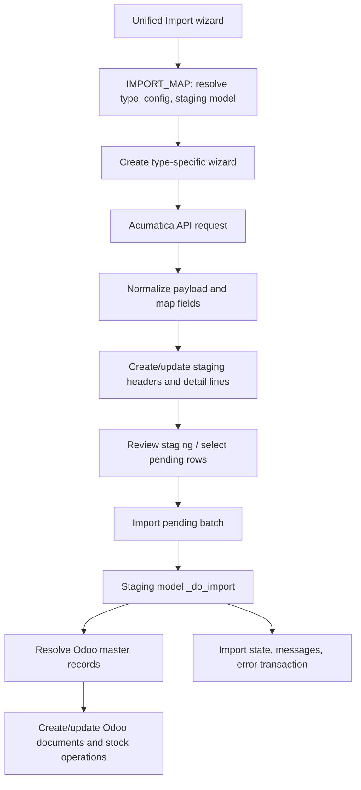

# Fetch and Import Architecture

## Overview

Fetch and import are separate stages. Fetch requests data from Acumatica and writes a normalized snapshot into staging models. Import processes staged rows and creates or updates Odoo business records. API Data Hub's unified wizard provides a common entry point, while type-specific wizards and models retain type-specific mapping and business rules.

## Data flow

Scheduled runs enter the same unified wizard through `models/scheduler/acumatica_cronjob.py`. Webhooks have a separate request/log/mapping path; they can eventually invoke staging imports, but are not the fetch wizard's API request path.

## Components

### Unified registry and wizard

`wizard/acumatica_unified_import_wizard.py` owns `IMPORT_MAP`, `MASTER_DATA_TYPES`, and `TRANSACTION_TYPES`. A registry entry identifies the label, source wizard model, configuration field, staging line model, and optional fields passed to the source wizard.

`action_fetch_data()` validates fetch limits and configuration, creates the source wizard, calls its `action_fetch_data()`, and summarizes staged/pending counts. `action_import_pending_batch()` searches staged rows for the mapped model, processes bounded batches, and calls the staging model's `_do_import()` implementation. This common entry point provides the interface, not identical per-type fetch/update logic.

### Type-specific fetch wizards

The source wizard owns the endpoint request, query parameters, response shape handling, payload mapping, and upsert to staging. They are under `wizard/master/` and `wizard/transaction/`. Master fetches usually write one staging row per master record. Transactions commonly split headers from detail rows and associate child lines with the staged header.

### Staging transaction models

Models under `models/transaction/` own staging fields, import state, master lookups, validation, and `_do_import()`. Their import methods create the corresponding Odoo records and stock operations. Some types store flattened data; others keep raw JSON/detail staging and use a specialized importer.

### Import state and errors

The unified import path selects rows with `import_state = 'staged'` and optionally limits them to the selected API configuration. Import handlers transition rows to created, updated, error, rejected, or another model-specific state and store an explanatory message. Transaction failures are also represented through `acumatica.error.transaction` where the handler uses that mechanism.

## Normal fetch and import sequence

1. Select a master or transaction key and a matching active API configuration.
2. Build the source wizard values, including common limits and applicable type-specific filters.
3. Authenticate to Acumatica, request the configured endpoint, and normalize response envelopes.
4. Map Acumatica headers and details into staging fields. The type-specific wizard decides whether existing rows are unchanged, updated, or created.
5. Review staged records or let the scheduler start the import phase.
6. Process staged rows in batches through `_do_import()`. The handler looks up products, partners, warehouses, locations, units of measure, and other required master records, then creates or updates Odoo documents.
7. Persist import state, messages, counters, and transaction errors for review and retry.

## Receipt comparison audit: transaction fetch checks

Receipt is the comparison baseline: it finds existing staging headers, compares Acumatica's `LastModifiedDateTime` with the saved write date, skips unchanged headers (and when the incoming date is absent), and, on change, writes the header and replaces all product staging lines with the current fetched snapshot.

All 18 keys in `TRANSACTION_TYPES` were mapped to their source wizard. Seventeen now use the Receipt-style write-date rule for their staged transaction snapshot; `inventory_adjustment` remains a separate detail-level upsert flow:

| Finding | Types | Current behavior |
| --- | --- | --- |
| Receipt-like write-date check and line replacement | `po_receipt`, `inventory_received`, `shipment_so`, `so_shipment`, `inventory_issue`, `issue_po_return`, `so_transfer`, `transfer_shipment`, `transfer_one_step`, `transfer_two_step`, `invoice_consignment`, `credit_memo_consignment`, `shipment_completed`, `shipment_transfer_completed`, `kit_assembly`, `vendor_return_direct_transfer`, `vendor_return_document_direct_transfer` | For the applicable transaction header, an equal or missing incoming write date skips an update; changed headers are updated and their staged detail snapshot is replaced. `kit_assembly` performs this check per assembly reference and handles components specially. `so_shipment` uses a nested GI header/detail structure but now classifies unchanged, updated, and new headers using this same rule. `inventory_issue` now skips unchanged headers and replaces product lines only when the write date changes. |
| Detail-level upsert without write-date comparison | `inventory_adjustment` | Each fetched detail is searched by reference/row/config (with Acumatica ID fallbacks) and written on every fetch. There is no stored `LastModifiedDateTime` comparison or Receipt-style child snapshot replacement. |

The categories describe the active fetch code paths; they do not establish that all Acumatica endpoints return complete snapshots or that write-date precision is identical across endpoints. In particular, missing write dates mean “skip” in Receipt-like paths, which can leave stale staging data if the source omits the field. The `so_shipment` source's preceding Shipment fetch still has its own nested payload flow; this staging comparison covers the Shipment GI snapshot persisted by the wizard.

## Master lookup audit: transaction models vs Receipt

Receipt's product lookup uses exact `product.product.default_code = inventory_id`; it does not fall back to barcode or product name. Vendor lookup tries `res.partner.company_registry`, then exact name, both restricted to companies. Warehouse lookup uses `stock.warehouse.code = building_code`. UoM lookup tries exact `uom.uom.name`, then falls back to the product's default UoM.

That is not a shared lookup contract across transaction models. Representative differences found in the 18 registered staging models:

| Master | Receipt baseline | Differences in transaction models |
| --- | --- | --- |
| Product | `default_code` only | `inventory_received`, `shipment_so`, `inventory_issue`, `issue_po_return`, transfer types, and some others also fall back to barcode and/or product name. Consignment and direct-transfer models may search active products by code, with one legacy code fallback. Some shipment handlers use bulk lookup or special location-aware matching. |
| Partner/vendor | `company_registry`, then name, company only | Other handlers use `ref`, `adt_b_account_id`, or a direct customer/vendor ID; fallback order and `is_company` filtering vary. Some transaction types do not use a partner lookup at all. |
| Warehouse/location | `stock.warehouse.code` from `building_code` | Transaction models may use `stock.location.acumatica` mapping records, warehouse code with active filtering, a location name fallback, or derive source/destination locations from operation type. Inventory Issue can fall back to an arbitrary first mapping when no code match exists. |
| UoM | exact name, then product UoM | Many models follow this pattern, but the source field varies by type; specialized handlers may use a different field or do not have a central `_find_uom()` helper. |

These differences can be intentional because Acumatica fields and transaction semantics vary, but they mean master resolution is not uniformly equivalent to Receipt. The most consequential candidates for a follow-up review are inventory issue's product-name fallback and warehouse fallback, and transaction partner lookups that replace `company_registry` with `ref` or an Acumatica-specific account field. This audit records current behavior only; it does not change matching rules.

## Source map

- `wizard/acumatica_unified_import_wizard.py` — registry, shared fetch dispatch, staging review, and import batches.
- `wizard/transaction/import_receipt_wizard.py` — Receipt reference behavior for fetch comparison and staged line replacement.
- `wizard/transaction/` — transaction-specific API requests, mapping, and staging upsert rules.
- `models/transaction/` — staging models, master resolution, validation, and business import handlers.
- `models/scheduler/acumatica_cronjob.py` — scheduled dispatch into unified fetch/import.
- `models/master/` — master staging and import models.
- `docs/webhook/architecture.md` — distinct webhook intake and processing architecture.

This is a source-level audit. It does not validate live API payload completeness, database contents, or production import outcomes.
