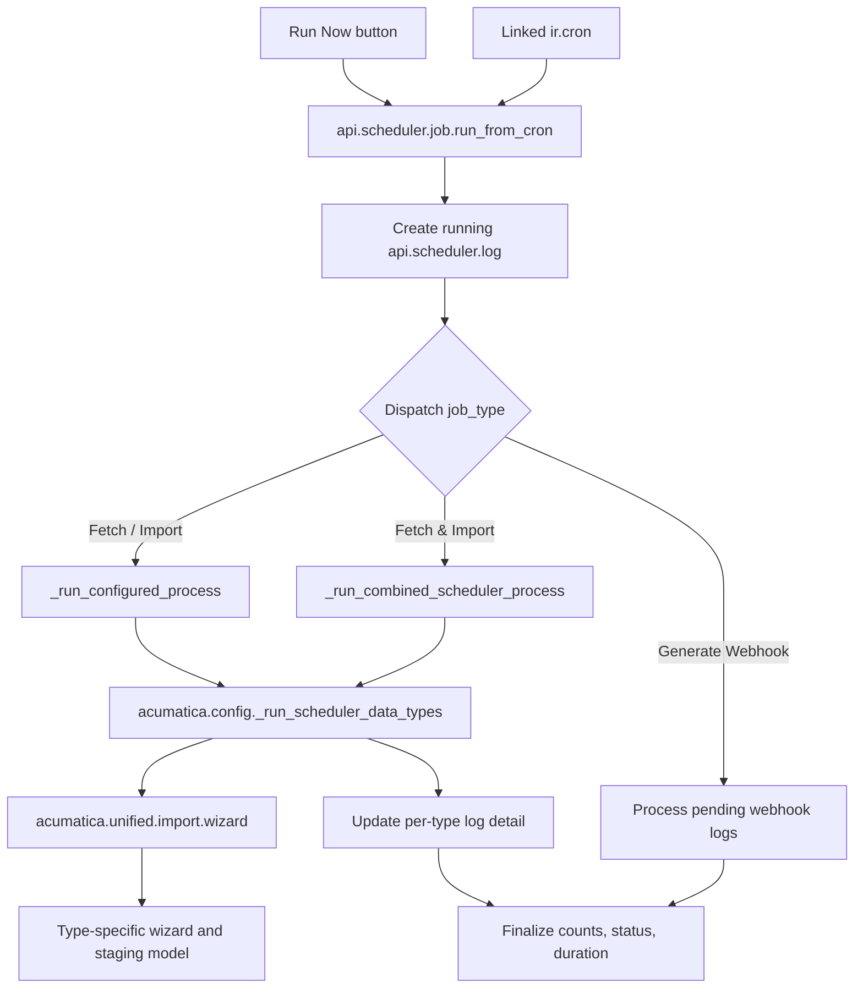

# Scheduler Architecture

## Overview

The API Data Hub scheduler is Odoo's configurable entry point for recurring and manual fetch/import runs. `api.scheduler.job` stores the operation and links to an `ir.cron`; the cron and the Run Now button both enter the same dispatcher. Fetch/import work is delegated to the unified import wizard and then to the wizard and staging model for the selected data type.

## Request and execution flow

The scheduler is an orchestrator, not a second implementation of each importer. The type-specific wizard owns the Acumatica request and staging upsert; the staging model owns Odoo business-record creation/update.

## Components

### `models/scheduler/api_scheduler.py`

Defines scheduler job, supported data-type catalog, parent logs, and per-type log details. `action_run_now()` and the linked cron call `run_from_cron()`. `_run_single_job()` handles availability, the optional overlap check, log lifecycle, exception capture, duration, and final status. `_run_configured_process()` dispatches the configured job type; `_run_combined_scheduler_process()` runs fetch first and passes eligible fetched types to import.

### `models/scheduler/acumatica_cronjob.py`

`_run_scheduler_data_types()` is the active per-data-type engine. It validates category and configuration, creates the unified import wizard, calls fetch or import, normalizes results, and updates live log details. Import-only runs are gated by the latest successful fetch log unless the run is the combined fetch-and-import path.

The file also contains older scheduler/import helpers. Current seeded cron records use `api.scheduler.job.run_from_cron()`; source references alone cannot rule out custom database actions calling legacy methods.

### `data/acumatica_cron_data.xml` and `data/api_scheduler_data_types.xml`

The first file seeds scheduler jobs and linked `ir.cron` actions. The second defines the selectable master and transaction data types. The canonical key lists and `IMPORT_MAP` live in `wizard/acumatica_unified_import_wizard.py`.

### Logging

`api.scheduler.log` records one overall execution. `api.scheduler.log.detail` records the result by data type: fetched rows, staged rows, created records, errors, and skipped rows. The parent log aggregates these values and captures status, message, and duration.

## Run modes

| Mode | Execution |
| --- | --- |
| Fetch all master / transaction | Fetch each registered key in the selected category into staging. |
| Import all master / transaction | Import eligible staged rows for types reported by the latest successful fetch. |
| Fetch & Import all master / transaction | Fetch first, then import types with a successful fetch and returned data. |
| Selected Fetch / Import | Apply the same process to one or more selected data-type keys. |
| Generate Webhook | Dispatch pending webhook logs to the webhook processor. |

The “Selected” mode supports multiple selected data types because its configuration field is Many2many.

## Operational behavior and limits

1. The dispatcher creates a running log and, when configured, checks `do_not_overlap` against `is_running`.
2. Each data type runs through the unified wizard and receives a log detail update.
3. The scheduler finalizes parent totals, result, and duration, and clears the running flag in its completion path.
4. Import-only mode verifies the latest corresponding fetch log and filters to types with retrieved data and no per-type errors.

The `is_running` check is best-effort, not an atomic cross-worker lock: simultaneous workers can both observe `False`. There is also no lease recovery if the worker stops before the cleanup path. A strict guarantee needs an atomic database lock/update and stale-run recovery.

## Source map

- `models/scheduler/api_scheduler.py` — job configuration, dispatcher, combined mode, and parent/detail log lifecycle.
- `models/scheduler/acumatica_cronjob.py` — per-type fetch/import engine and legacy scheduler helpers.
- `data/acumatica_cron_data.xml` — seeded scheduler jobs and `ir.cron` actions.
- `data/api_scheduler_data_types.xml` — selectable master/transaction types.
- `views/scheduler/api_scheduler_views.xml` — scheduler and log screens.
- `wizard/acumatica_unified_import_wizard.py` — canonical type registry and common fetch/import batch entry points.
- `docs/api-scheduler-architecture.md` — extended scheduler field, method, and legacy-code inventory.

This document describes source and XML wiring. It does not prove that a live database's cron records match the XML or that a production run completed successfully.
